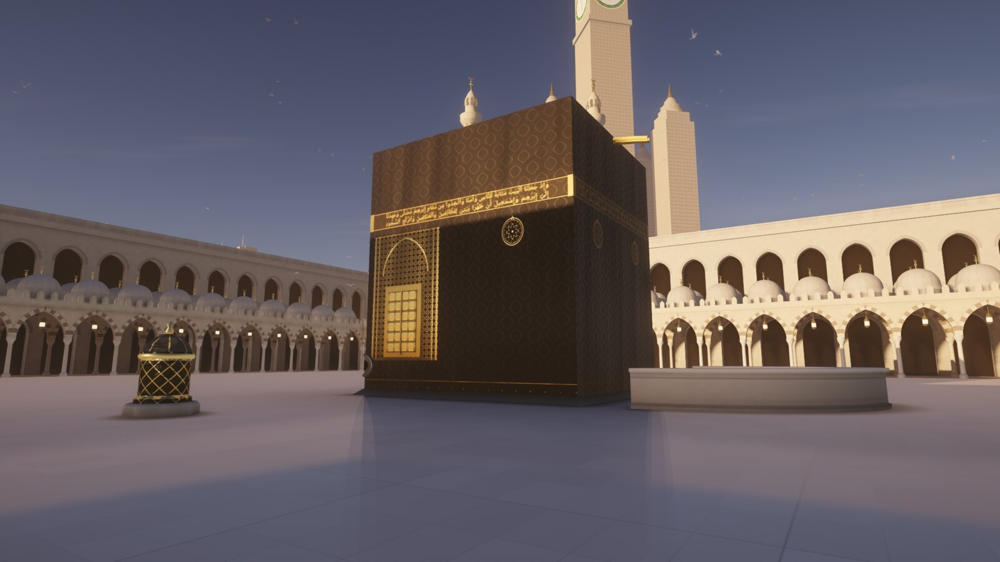
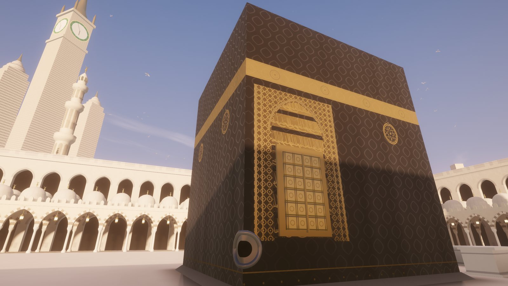
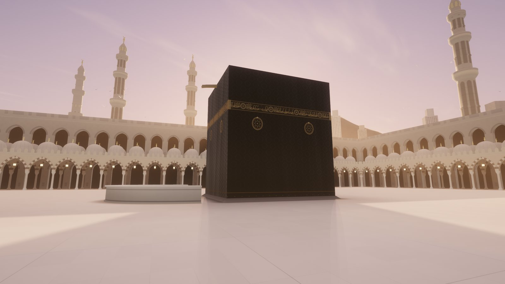
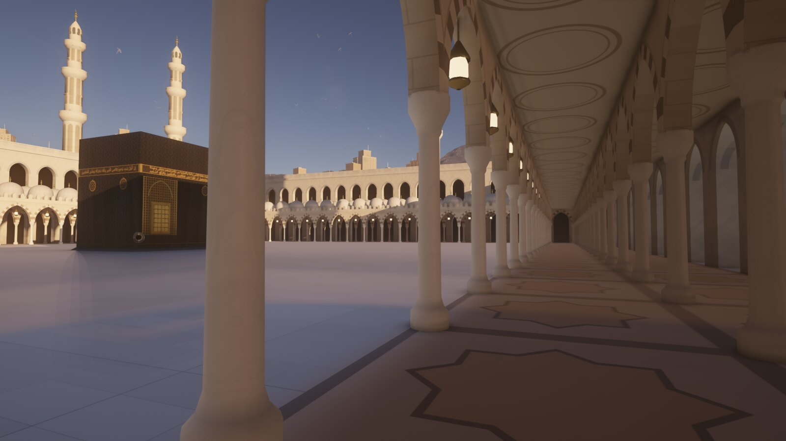
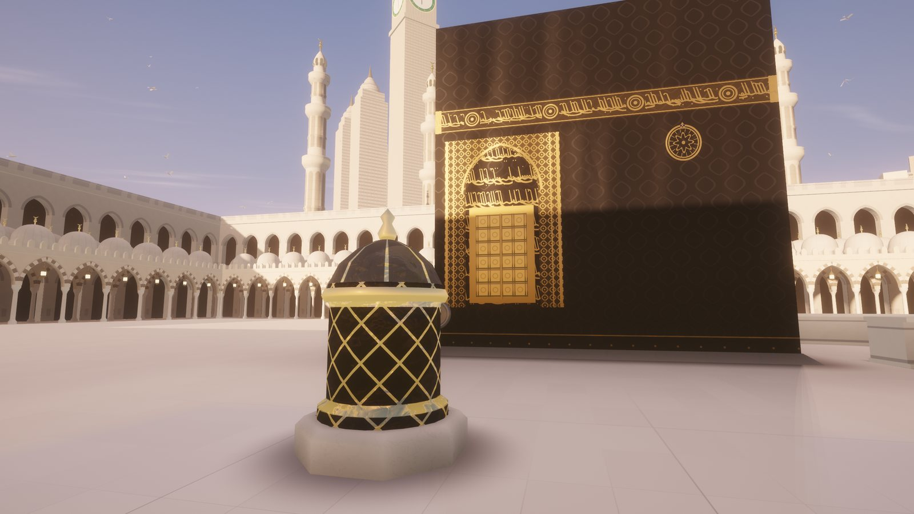
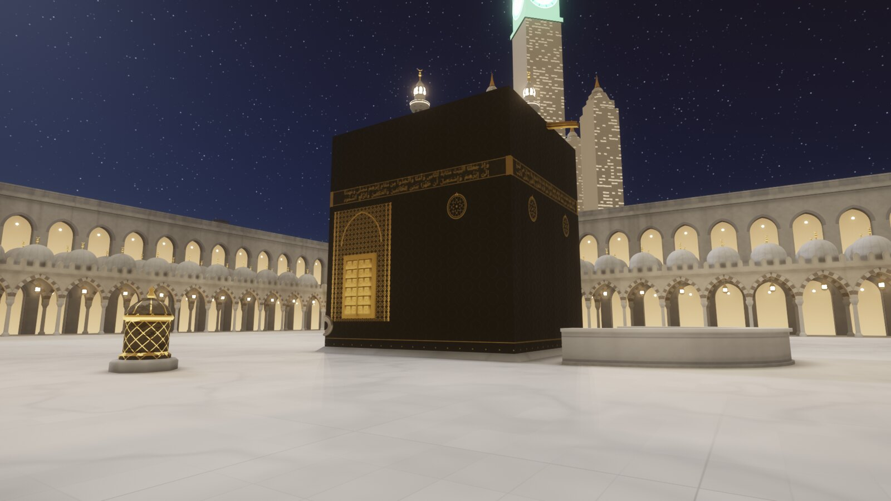
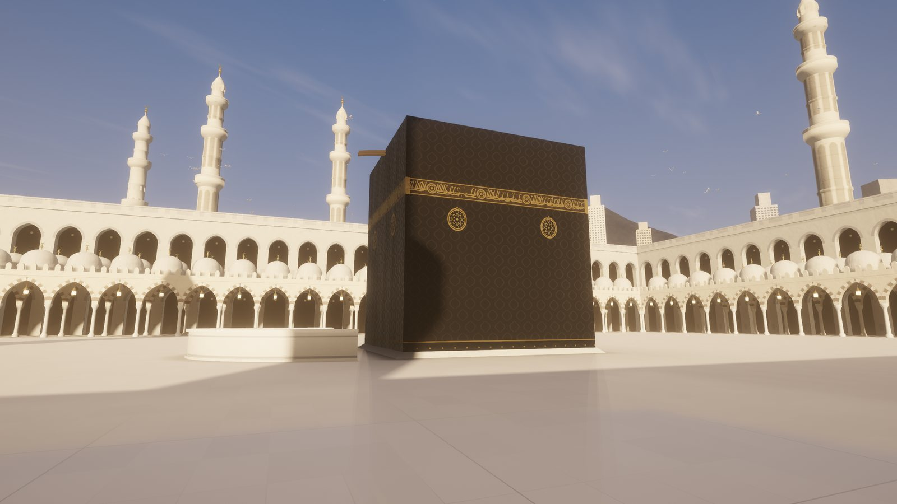
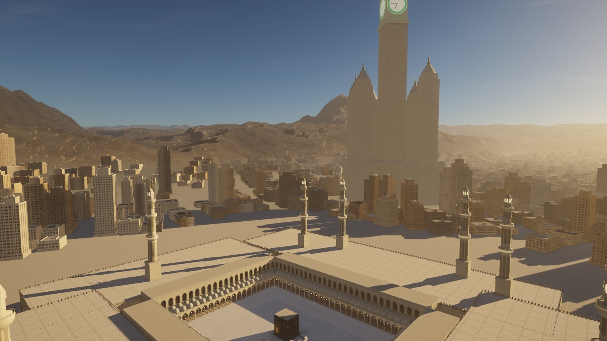

# Makkah Haram

<p align="center">
  <a href="https://moeymakes.github.io/makkah-haram/"></a>
</p>
<p align="center"><b><a href="https://moeymakes.github.io/makkah-haram/">moeymakes.github.io/makkah-haram/</a></b><br>
<sub>Chrome or Edge on a desktop or laptop (needs WebGPU) · nothing to install · one HTML file</sub></p>

**Walk the white marble Mataf round the Kaaba in Masjid al-Haram, Makkah, right in your browser: at dawn, at golden
hour or at night.**

The Kaaba in its black Kiswah with the gold band and the gold door, the Black Stone corner in its silver frame, the
curved white wall of the Hijr Ismail, Maqam Ibrahim in its gold-and-glass enclosure, the Ottoman arcades with their
rows of small domes and hanging lanterns, the later arcade behind them, thirteen minarets and the clock tower over
the city, with the granite mountains of the Makkah valley in the haze. Everything is made by code: no images, no 3D
models, no sound files. The whole world is **one HTML file** of about 88 KB (36 KB gzipped).

The buildings are respectful approximations, not replicas, and the geography is composed: the arcades, the minarets
and the clock tower are placed so they read from the Mataf, and the distances are not to scale. The spaces are
empty: there are no people, nothing inside the Kaaba exists, and nothing is recited. The gold embroidery is an
abstract pattern in the rhythm of calligraphy, with no letters or words in it, and the clock faces carry no lettering.

[](https://moeymakes.github.io/makkah-haram/)

| | |
|---|---|
|  |  |
|  |  |
|  |  |



## Try it

1. Open **[https://moeymakes.github.io/makkah-haram/](https://moeymakes.github.io/makkah-haram/)** in **Chrome** or
   **Edge** on a desktop computer, or download [`index.html`](index.html) and open it from your computer (it works
   offline).
2. Wait a moment while the Haram is built, pick a **Time** if you like, then press **Enter** and start walking.

It needs a browser with **WebGPU**.

## What's there

- **The Kaaba**: black silk with a woven pattern that shows in its sheen, the gold band two-thirds up, gold medallions
  beneath it, the gold door raised above the floor in its embroidered surround, the sloped marble base, the gold
  water spout over the Hijr, and the Black Stone corner in its silver frame
- **The belt's verses in real Arabic**, one on each wall, read right to left as you face it: 2:125 on the door
  wall, 3:96 between the two corners, 22:26 on the south-west wall, 2:197 on the Hijr side. The text is the
  Uthmani Hafs text from [quran.ai](https://quran.ai), copied byte for byte by `source/text/make-kiswah.mjs`, and set
  in Noto Naskh Arabic. The real belt is hand-composed Thuluth Jali by the calligraphers of the King Abdulaziz
  Complex for the Kiswa; this is a clear typeset rendering of the same verses, not a copy of their artwork
- **The Hijr Ismail** and **Maqam Ibrahim**, the white **Mataf** that mirrors the Kaaba
- **The Ottoman arcades**: pointed arches with banded voussoirs on slender marble columns, a small dome with a
  crescent finial over every bay, lanterns in the arches; you can walk their aisles
- **The later arcade** behind them, the larger expansions, **thirteen minarets** and **the clock tower** to the south
- **Three times of day**: Dawn (the first sun on the upper Kaaba and the western arcades, the rest of the Mataf still
  in shade), Golden hour, and Night (floodlit marble, lit arcades and minarets, the lit clock face, stars and the moon)
- **Pigeons** circling, dust in the low sun
- **Sound** made up as you listen: wind, a distant city hum (loudest at night), pigeons and small birds in the
  morning. Nothing is recited.

## Controls

| | Keyboard & mouse |
|---|---|
| Look around | Move the mouse (or drag with the left button where the mouse cannot be captured) |
| Walk | `W` `A` `S` `D` |
| Run | Hold `Shift` |
| Fly / walk | `F`, or `E` to lift off from walking |
| Up / down | `E` / `Q` (descending onto the ground lands you back to walking) |
| Jump to a viewpoint | `1` to `6` |
| Menu | `Esc` |
| Sound on / off | `M` |
| Performance stats | `H` |
| Time of day | **Dawn**, **Golden hour** or **Night** in the menu (reloads the page) |
| Sound | **Haram**, **Wind**, **Birds**, **Calm** or **Off**, and a volume slider, in the menu |
| Detail level | **Low**, **Medium** or **High** in the menu (reloads the page) |

**On a touchscreen:** hold one finger down to walk forward and slide it to look around; a second finger runs;
the ✈ button toggles flight.

## How it works

- Everything near the Kaaba is built in the Kaaba's own frame (turned 45 degrees, so its corners point roughly at the
  compass points) from a few mesh shapes: boxes, lathes, arch panels, sweeps. Walking and collision run in the same
  frame.
- The Kiswah, the embroidery, the door, the marble and the clock faces are drawn per pixel, with every line filtered
  to the pixel's footprint so they stay clean in the distance. The floor's reflection of the Kaaba and the arcades is
  worked out from simple shapes rather than by drawing the scene twice.
- The time of day is chosen before the world is built: the sun (or the moon), the sky colours, the lamps and the
  shadow map are baked for it, so each look costs nothing extra while you walk.
- The surroundings out to 12 km come from one ground function evaluated on the graphics card.
- Everything is drawn with **WebGPU** directly. No engine or 3D library.
- The method, the verification loop and the page structure follow
  [Abyssal Garden](https://github.com/noniv/abyssal-garden) (MIT), via the `worldsmith` skill, by way of the sibling
  worlds Nabawi Courtyard and Madinah Horizon.

## Make it your own

Source is in [`source`](source). Rebuild with Node.js 18+:

```bash
cd source && npm install && npm run build
```

| File | What's inside |
|---|---|
| [`source/src/world.js`](source/src/world.js) | Layout and time-of-day presets: the Kaaba, Hijr, Maqam, arcades, minarets, clock tower, city, viewpoints and the camera path |
| [`source/src/shaders.js`](source/src/shaders.js) | Sky and haze, the Kiswah and its embroidery, marble, stone, gold and clock materials, lamps and floodlight, sun shafts and the final image |
| [`source/src/main.js`](source/src/main.js) | Renderer, walking and flying, collision, controls, the Time and Detail menus |
| [`source/src/audio.js`](source/src/audio.js) | The soundscape and the Sound menu |
| [`source/src/quality.js`](source/src/quality.js) | Detail levels and the stored time of day |
| [`source/template.html`](source/template.html) | The page: loading bar, menu, controls list |

`npm run build:dev` writes `dev.html` with a scripted one-minute flight (`P`) and a benchmark (`B`).

## Other worlds in this series

- **[Madinah Horizon](https://moeymakes.github.io/madinah-horizon/)**: the date gardens, lava fields and hills around Madinah at golden hour, with the Prophet's Mosque and Uhud on the horizon ([source](https://github.com/moeymakes/madinah-horizon))
- **[Nabawi Courtyard](https://moeymakes.github.io/masjid-nabawi-courtyard/)**: the marble plaza of the Prophet's Mosque up close, as the great umbrellas open ([source](https://github.com/moeymakes/masjid-nabawi-courtyard))
- **[Madinah, First Years](https://moeymakes.github.io/madinah-first-years/)**: the oasis and the first mosque around 622-632 CE, an artistic reconstruction ([source](https://github.com/moeymakes/madinah-first-years))

## License

MIT. Parts adapted from Abyssal Garden (MIT); its notice is in `source/LICENSE-abyssal-garden`.
The embedded font is a subset of Noto Naskh Arabic Bold, Copyright 2022 The Noto Project Authors, under the SIL Open
Font License 1.1 (`source/text/OFL-NotoNaskhArabic.txt`).
